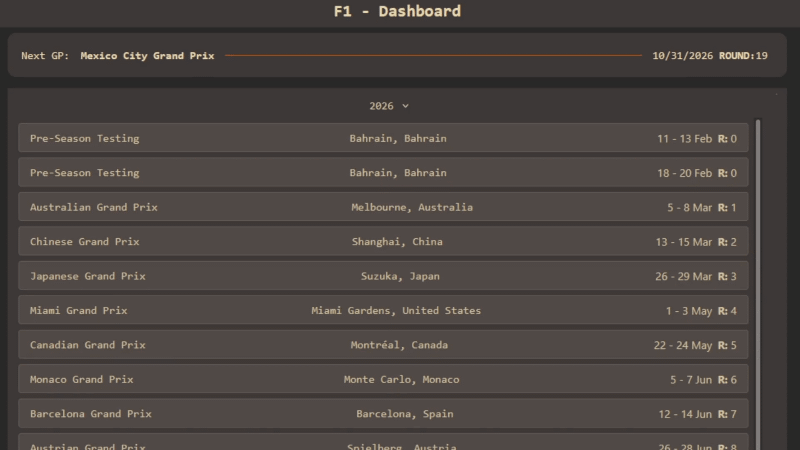

# F1 Dashboard
 
A fan-built Formula 1 dashboard: race schedules, results, and AI-summarized
car development updates — no login required.
 
> **Unofficial project.** Not affiliated with, endorsed by, or connected to
> Formula One Management Limited, Formula One Licensing B.V., the FIA, or
> any F1 team or driver. Built for personal/educational use using publicly
> accessible data via [FastF1](https://github.com/theOehrly/Fast-F1) and the
> FIA's public car presentation documents.
 
## Demo
Try it right now [here](https://f1-dashboard-ivory-eta.vercel.app/) 



## What's built so far
 
### Backend (`app/`)
FastAPI service exposing:
- `GET /api/schedule/{year}` — full season schedule
- `GET /api/schedule/{year}/current` — the current or next upcoming race weekend
- `GET /api/upgrades/{year}/{round}` — AI-generated per-team summaries of car updates
- `GET /api/upgrades/{year}/{round}/{team}` - a single team's update summary
Schedule and results data comes from FastF1, with a local JSON cache layer
(`cache/`) so the app doesn't hit FastF1's API on every request — data is
refreshed on a time-based staleness check rather than fetched live per call. 
- `GET /api/results/{year}/{round}/{session_type}` - session results for a given round
- `GET /api/laps/{year}/{round}/{session_type}/{driver}` - lap data for a driver in a given gp

### Car update summarizer pipeline (`scraper/`)
Runs independently of the API (its own scheduled job, not triggered by
requests):
- `downloader.py` — pulls the FIA's official car presentation PDF for a
  given year/Grand Prix
- `processor.py` — parses the PDF into structured rows (team, component,
  reason, geometric differences, description), correctly handling FIA's
  merged table cells (shared reasons/descriptions across multiple
  components)
- `summarizer.py` — generates a short, fan-readable summary per team via
  an LLM, from the structured data (never from raw PDF text)
- `run_weekend.py` — orchestrates the above end to end for the current
  race weekend
Output lives in `data/`, which the FastAPI app reads from directly.

## Planned
 
- Frontend (schedule, results, and upgrade summaries UI)
- Tyre specs/sets, circuit lap records, past winners per circuit
- ML-based pit-stop strategy prediction, layered on top of the dashboard

## Data pipeline

Data comes from two sources:

- **FastF1**: schedule, results and lap data.
- **FIA car presentation documents**: the official PDF is downloaded and parsed into a
  structured table, then an LLM (via Groq) writes a per-team summary of the upgrades.

To keep responses fast, every result is stored as JSON the first time it is fetched, so
nothing is requested from these sources twice. This trades a small amount of storage
(~<X> MB for a full season) for much lower latency.

The deployed backend runs on Render, whose free tier has an ephemeral disk, so files
created at runtime would be lost on every restart. Instead, the processed data is
committed to this repository, and the API runs in read-only mode in production: it only
serves committed files and never calls FastF1 or the FIA site at request time. 

## Tech stack
 
- **Backend:** FastAPI, pandas
- **Data:** FastF1, FIA public documents (PDF)
- **AI:** Groq (per-team update summaries)
- **Frontend:** React, Typescript, TailwindCSS, Vite
## Local setup
 
```bash
python -m venv .venv
source .venv/bin/activate
pip install -r requirements.txt
```
 
Environment variables (`.env`, not committed):
```
GROQ_API_KEY=your_key_here
```
 
Run the API:
```bash
python -m uvicorn app.main:app --reload
```
 
Run the update-summary pipeline manually:
```bash
python scraper/run_weekend.py
```

## Known limitations and future work

- **Cold starts.** The free Render tier sleeps after inactivity, so the first request can
  take a while to respond.
- **Upgrade summaries depend on name matching.** The FIA doesn't offer an API for team
  upgrades, so the scraper downloads the official PDF from the FIA website. The Grand Prix
  name in FastF1 must match the one used in the FIA document, and when they differ
  (for example, <FastF1 name> vs <FIA name>), the lookup fails. 
> Example of this is the Bahrein GP in Malasyia in 2026, also the GP before 2024 use another filename format

- New race weekends would be ideally added by a scheduled GitHub Action that runs the pipeline and commits the new files, which triggers a redeploy.
